# Mini NPU 시뮬레이터

MAC(Multiply-Accumulate) 연산으로 입력 패턴이 십자가(Cross)인지 X인지 판정하는 Python 콘솔 프로그램입니다.
3×3부터 25×25까지 여러 크기의 패턴을 판정하고, 크기가 커질 때 연산 시간이 어떻게 변하는지 측정합니다.
외부 라이브러리 없이 표준 라이브러리(`json`, `time`)만 사용했습니다.

## 실행 방법

- Python 3.8 이상이 필요합니다.
- `main.py`와 `data.json`을 같은 폴더에 둡니다.

```powershell
py main.py
```

실행하면 모드를 선택합니다. 잘못된 값을 입력하면 안내 문구가 나오고 다시 물어봅니다.

| 선택 | 모드 | 하는 일 |
|---|---|---|
| `1` | 사용자 입력 (3×3) | 필터 A, 필터 B, 패턴을 한 줄씩(공백으로 구분) 입력하면 MAC 점수, 연산 시간, 판정(A/B/판정 불가)과 3×3 성능 표를 보여줍니다. |
| `2` | data.json 분석 | `data.json`의 필터와 패턴을 읽어 케이스별 판정과 PASS/FAIL, 크기별 성능 표, 결과 요약을 보여줍니다. |

모드 1은 아래처럼 입력하면 됩니다. (십자가 필터, X 필터, X 모양 패턴)

```text
필터 A: 0 1 0 / 1 1 1 / 0 1 0
필터 B: 1 0 1 / 0 1 0 / 1 0 1
패턴:   1 0 1 / 0 1 0 / 1 0 1
```

다음은 모드 1의 실행 결과입니다. 패턴이 X 모양이라서 X 필터(B)의 점수가 더 높게 나옵니다.

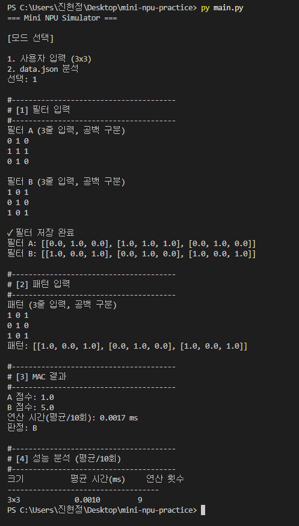

## 파일 구조

```text
mini-npu-practice/
├── main.py              # 메인 실행 파일
├── data.json            # 필터(5×5, 13×13, 25×25)와 패턴, expected가 들어 있는 데이터
├── error_data.json      # 오류 처리 시험용 데이터 (일부러 틀린 케이스 포함)
├── README.md            # 설명서
└── docs/
    └── screenshots/     # 실행 결과 캡처 이미지
```

## 구현 요약

이 프로그램의 핵심 구현은 세 가지입니다.

- **라벨 정규화**: data.json에는 같은 뜻의 라벨이 `+`, `x`, `cross`처럼 여러 모양으로 들어 있습니다.
  프로그램 안에서는 `normalize_label()`로 표준 라벨 `Cross`, `X` 두 가지로 통일한 뒤 판정하고 PASS/FAIL을 비교합니다.
- **MAC 연산**: 입력 패턴과 필터의 같은 위치 값끼리 곱한 뒤 모두 더한 값이 점수입니다.
  NumPy 같은 외부 라이브러리 없이 이중 `for` 반복문으로 직접 구현했고(`mac()`), N×N 배열이면 곱셈을 N²번 합니다.
- **동점 처리 정책(epsilon)**: 부동소수점 오차 때문에 같은 점수가 조금 다르게 계산될 수 있으므로,
  두 점수의 차이가 `1e-9`보다 작으면 동점으로 보고 `UNDECIDED`(판정 불가)로 처리합니다.

각 항목의 자세한 내용은 아래에 순서대로 정리했습니다.


### 데이터 구조

패턴과 필터는 파이썬의 2차원 리스트(리스트 안에 리스트)로 저장합니다.
n×n 크기이면 줄이 n개이고, 각 줄에 칸이 n개 있습니다.

- `make_matrix(n)`: n×n 크기의 표를 만들고 모든 칸을 0.0으로 채웁니다.
- `get_value(matrix, row, col)`: row번 줄, col번 칸의 값을 읽어서 반환합니다.
- `set_value(matrix, row, col, value)`: row번 줄, col번 칸에 값을 저장합니다.

같은 함수로 3×3, 5×5, 13×13, 25×25 크기를 모두 만들 수 있습니다.
줄 번호와 칸 번호는 파이썬 규칙에 따라 0부터 시작합니다.

다음은 3×3 표를 만들고 정가운데 칸(1번 줄 1번 칸)에 1.0을 저장한 뒤 읽어 온 결과입니다.

```python
m = make_matrix(3)
set_value(m, 1, 1, 1.0)
print(get_value(m, 1, 1))
print(m)
```

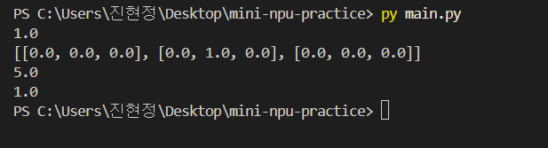

### MAC 연산

MAC(Multiply-Accumulate) 연산은 두 배열의 같은 위치 값끼리 곱하고(Multiply),
그 결과를 모두 더해서 쌓는(Accumulate) 연산입니다.
이 프로그램에서는 입력 패턴과 필터를 같은 자리끼리 곱한 뒤 모두 더한 값을 점수로 사용합니다.
점수가 높을수록 입력 패턴이 필터와 많이 겹친다는 뜻이므로, 모양이 비슷하다고 볼 수 있습니다.

예를 들어 십자가 패턴과 십자가 필터의 점수는 5.0, 십자가 패턴과 X 필터의 점수는 1.0입니다.

다음은 터미널에서 `py main.py`를 실행했을 때의 결과입니다.

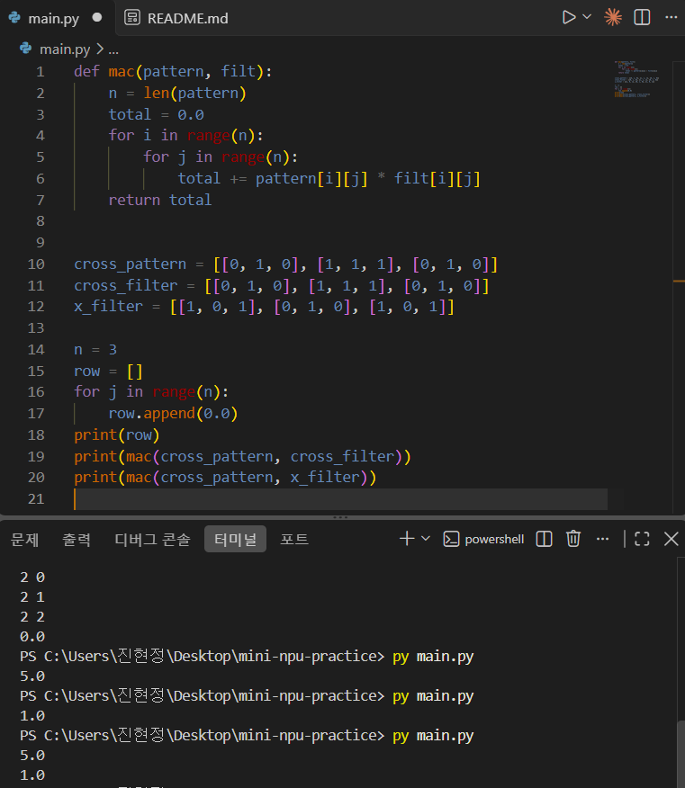

### 구현 방법

`mac(pattern, filt)` 함수에서 이중 `for` 반복문으로 모든 칸을 한 번씩 방문합니다.
바깥 반복문은 줄(i)을, 안쪽 반복문은 칸(j)을 돌고, 각 칸에서
`pattern[i][j] * filt[i][j]`를 계산해 `total` 변수에 더한 뒤 마지막에 `total`을 반환합니다.
NumPy 같은 외부 라이브러리는 사용하지 않고 반복문으로 직접 구현했습니다.

### 연산 횟수

N×N 크기의 배열이면 칸이 N×N개이고, 칸마다 곱셈을 한 번씩 하므로 곱셈은 N²번 합니다.
3×3이면 9번, 5×5이면 25번입니다.

### 동점 처리 정책 (epsilon)

두 점수를 비교할 때 `>`나 `==`만 쓰면 부동소수점 오차 때문에 잘못된 판정이 나올 수 있습니다.
컴퓨터는 0.1 같은 소수를 2진수로 정확히 저장하지 못해서, 예를 들어 `0.1 + 0.2`가 `0.3`이 아니라
`0.30000000000000004`가 됩니다. 이 오차 때문에 사실은 같은 점수인데도 한쪽이 더 크다고 판정할 수 있습니다.

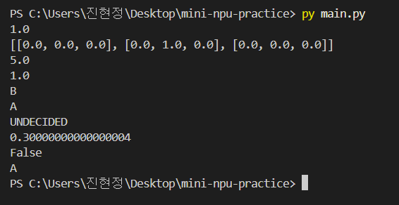

이를 막기 위해 허용오차(epsilon)를 사용합니다. 두 점수의 차이가 `EPSILON`(1e-9)보다 작으면
같은 점수로 보고 `UNDECIDED`(판정 불가)로 처리합니다.

```python
EPSILON = 1e-9


def judge(score_a, score_b):
    if abs(score_a - score_b) < EPSILON:
        return "UNDECIDED"
    elif score_a > score_b:
        return "A"
    else:
        return "B"
```

동점 검사를 가장 먼저 하고, 동점이 아닐 때만 큰 쪽을 고릅니다.
같은 입력(`0.1 + 0.2`와 `0.3`)이 epsilon을 적용한 뒤에는 `UNDECIDED`로 정상 판정됩니다.

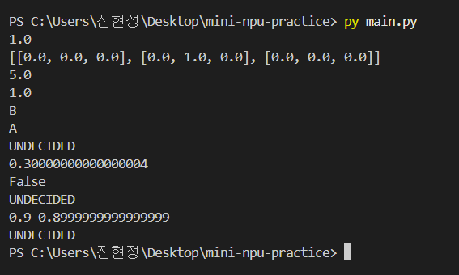

화면 맨 아래의 `0.9 0.8999999999999999`는 사람 눈에는 같은 값이지만 컴퓨터에서는 아주 조금 다른 값입니다.
epsilon을 적용하면 이 둘도 동점으로 보고 `UNDECIDED`로 판정합니다.

### 라벨 정규화

data.json에는 같은 뜻의 라벨이 여러 모양으로 들어 있습니다.
`expected` 값은 `"+"`, `"x"`로, 필터 이름은 `"cross"`, `"x"`로 적혀 있습니다.
프로그램 내부에서는 표준 라벨 `Cross`, `X` 두 가지만 사용하도록 `normalize_label()` 함수로 바꿉니다.

| 원래 값 | 표준 라벨 |
|---|---|
| `+`, `cross` | `Cross` |
| `x` | `X` |

컴퓨터는 `"x"`와 `"X"`를 서로 다른 글자로 비교합니다. 정규화하지 않으면 판정이 `X`로 맞게 나와도
expected가 `"x"`라서 다르다고 보고 FAIL이 될 수 있습니다. 그래서 판정 결과와 expected를
모두 표준 라벨로 바꾼 뒤에 비교합니다.

```python
LABEL_MAP = {"+": "Cross", "cross": "Cross", "x": "X"}


def normalize_label(raw):
    key = raw.strip().lower()
    return LABEL_MAP.get(key)
```

`.strip()`으로 앞뒤 공백을 지우고 `.lower()`로 소문자로 바꾼 뒤 대응표(`LABEL_MAP`)에서 찾기 때문에
`" X "`, `"Cross"` 같은 값도 같은 라벨로 처리됩니다. 표에 없는 값은 `None`을 반환합니다.

`judge()`는 돌려줄 라벨 이름을 재료로 받을 수 있게 했습니다. 이름을 넣지 않으면 기본값 `"A"`, `"B"`를
사용하므로 모드 1(A/B 판정)과 모드 2(Cross/X 판정)에서 같은 함수를 씁니다.

```python
def judge(score_a, score_b, label_a="A", label_b="B"):
    if abs(score_a - score_b) < EPSILON:
        return "UNDECIDED"
    elif score_a > score_b:
        return label_a
    else:
        return label_b
```

다음은 정규화와 판정을 확인한 결과입니다.

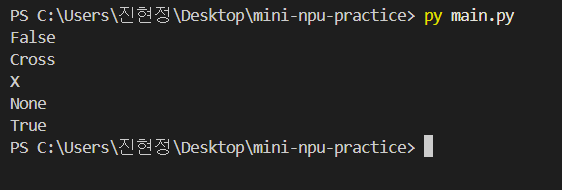

### 모드 1: 3×3 직접 입력

필터 A, 필터 B, 패턴을 한 줄씩(공백으로 구분) 입력받아 MAC 점수와 연산 시간, 판정 결과를 보여줍니다.
`read_matrix(title, n)`이 n줄을 받고, 한 줄은 `read_row(n)`이 받습니다.
점수는 `mac()`으로 계산하고 `judge()`로 A/B/판정 불가를 정합니다.

다음은 십자가 필터(A), X 필터(B), X 모양 패턴을 입력한 결과입니다.
패턴이 X 모양이라서 X 필터(B)의 점수가 더 높게 나옵니다.


### 입력 검증

한 줄에 숫자가 3개가 아니거나 숫자로 바꿀 수 없는 값이 들어오면 안내 문구를 보여주고 같은 줄을 다시 입력받습니다.

- 숫자가 아닌 값(`a b c`): `float()`로 바꿀 때 `ValueError`가 나므로 `try`/`except`로 받아 안내 문구를 출력합니다.
- 개수가 맞지 않는 값(`0 1`, `0 1 0 1`): `len()`으로 개수를 확인합니다.
- 맞는 값이 들어올 때까지 `while True:`로 반복하고, 맞으면 `break`로 빠져나옵니다.
- 입력 앞뒤의 공백은 `.split()`이 알아서 정리합니다.

처음에는 숫자가 아닌 값(`a b c`)을 입력하면 에러가 나며 프로그램이 멈췄습니다.

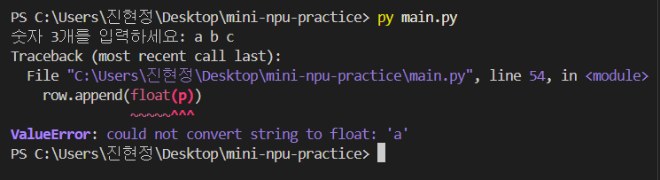

`try`/`except`를 적용한 뒤에는 에러 대신 안내 문구가 나옵니다.

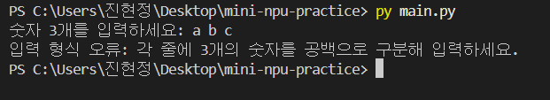

숫자 개수가 맞지 않을 때(`0 1`, `0 1 0 1`)도 안내 문구가 나오고, 숫자 3개(`0 1 0`)는 정상 처리됩니다.

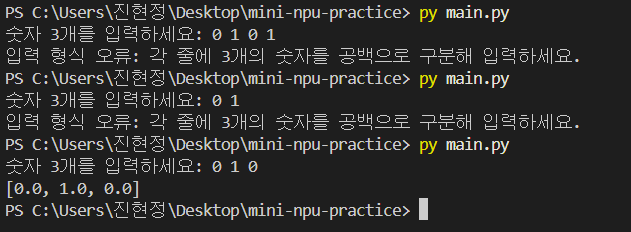

완성한 모드 1에서 잘못된 줄을 입력하면 다시 입력받고, 이어서 끝까지 진행됩니다.

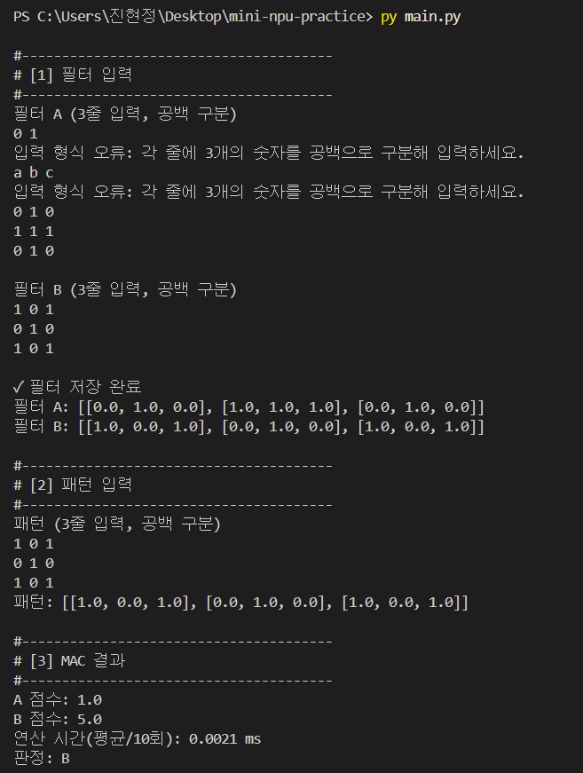

### 연산 시간

`time.perf_counter()`로 `mac()` 호출 구간의 시작 시각과 끝난 시각을 재서 걸린 시간을 구합니다.
입력, 출력, 파일 읽기 시간은 포함하지 않습니다.
실행할 때마다 값이 조금씩 달라서 10번 반복 측정한 평균(ms)을 사용합니다. 1초는 1000ms이므로 초 단위 값에 1000을 곱합니다.
모드 1에서는 필터 A, 필터 B 각각 10번씩 잰 평균을 다시 평균 내어 보여줍니다.


### 모드 2: data.json 분석

`data.json`에서 필터와 패턴을 읽어 한꺼번에 판정합니다. 파일은 `main.py`와 같은 폴더에 둡니다.

- `filters`: `size_5`, `size_13`, `size_25` 필터가 들어 있고, 각각 `cross`와 `x` 필터가 있습니다.
- `patterns`: `size_{N}_{idx}` 이름의 패턴이 들어 있고, 각각 `input`(2차원 배열)과 `expected`(정답)가 있습니다.
- 패턴 이름 `size_5_1`을 `_`로 잘라 가운데 숫자(5)를 크기 N으로 꺼내고, `size_5` 필터를 골라 점수를 계산합니다.
- 필터 이름(`cross`, `x`)과 `expected` 값(`+`, `x`)은 `normalize_label()`로 표준 라벨 `Cross`, `X`로 바꾼 뒤 비교합니다.
- 판정이 `expected`와 같으면 PASS, 다르면 FAIL입니다. 동점(`UNDECIDED`)은 판정으로 인정하지 않으므로 FAIL입니다.

### 스키마 검증과 케이스 단위 FAIL 처리

패턴마다 `analyze_pattern()`이 아래 순서로 검사하고, 문제가 있으면 그 패턴만 사유와 함께 FAIL로 기록한 뒤 다음 패턴으로 넘어갑니다. 프로그램은 멈추지 않습니다.

1. 이름이 `size_N_idx` 모양인가?
2. `input`과 `expected`가 모두 있는가?
3. `expected`를 `Cross`/`X`로 정규화할 수 있는가?
4. 해당 크기의 필터(`size_N`)가 있고, `cross`와 `x`가 모두 있는가?
5. 패턴이 N×N 크기인가? (`check_matrix()`)

검증 기능을 만들기 전에 일부러 틀린 데이터(`error_data.json`)로 실행하면 크기가 4×4인 패턴이 에러 없이 엉뚱한 점수로 PASS가 나왔고,
`size_7` 필터가 없는 패턴에서는 `KeyError`로 프로그램이 멈췄습니다.

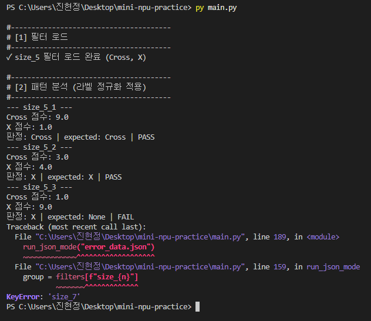

검증을 추가한 뒤에는 같은 데이터로도 멈추지 않고, 케이스마다 사유와 함께 FAIL로 처리하며 마지막 요약까지 출력합니다.

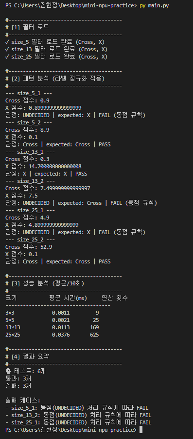

`error_data.json`에는 아래 문제를 일부러 넣었습니다.

| 패턴 | 문제 |
|---|---|
| `size_5_2` | 크기 불일치 (4×4 패턴, 5×5 필터) |
| `size_5_3` | 알 수 없는 expected 라벨 (`cross??`) |
| `size_7_1` | `size_7` 필터 없음 |
| `size_5_4` | `input` 누락 (스키마 오류) |
| `pattern_abc` | 이름이 `size_N_idx` 모양이 아님 |

### 성능 분석

크기별 MAC 연산 시간을 ms 단위로 측정해 표로 보여줍니다. 표에는 크기(N×N), 평균 시간(ms), 연산 횟수(N²)가 들어 있습니다.

- 측정 대상은 `mac()` 호출 구간뿐입니다. 입력, 출력, 파일 읽기 시간은 포함하지 않습니다.
- 한 번만 재면 값이 매번 조금씩 달라지므로 10번 반복해서 잰 평균을 사용합니다.
- 처음 실행은 준비 시간 때문에 느려서 평균에 섞이지 않도록 측정 전에 한 번 미리 실행(워밍업)합니다.
- 측정에 쓸 3×3, 5×5, 13×13, 25×25 패턴은 패턴 생성기(`generate_cross`)로 만듭니다.
- 모드 1은 3×3만, 모드 2는 3×3·5×5·13×13·25×25를 측정합니다.

```python
def measure_mac_ms(pattern, filt, repeat=10):
    mac(pattern, filt)
    total_time = 0.0
    for i in range(repeat):
        start = time.perf_counter()
        mac(pattern, filt)
        end = time.perf_counter()
        total_time += end - start
    return total_time / repeat * 1000
```

`time.perf_counter()`로 시작 시각과 끝난 시각을 재서 걸린 시간(초)을 구하고, 1000을 곱해 ms로 바꿉니다.

실행 결과 예시 (컴퓨터마다 값은 조금씩 다릅니다):

```text
크기           평균 시간(ms)     연산 횟수
------------------------------------
3×3             0.0010         9
5×5             0.0020        25
13×13           0.0099       169
25×25           0.0342       625
```


## 보너스: 패턴 생성기

크기 N을 넣으면 N×N 십자가(Cross)와 X 패턴을 자동으로 만드는 함수를 만들었습니다.
`make_matrix()`로 모든 칸이 0.0인 표를 만들고 `set_value()`로 필요한 칸만 1.0으로 바꿉니다.

- `generate_cross(n)`: 가운데 줄과 가운데 칸을 1.0으로 만듭니다. 가운데 번호는 `n // 2`입니다.
- `generate_x(n)`: 왼쪽 위에서 오른쪽 아래로 가는 대각선 `(k, k)`와
  오른쪽 위에서 왼쪽 아래로 가는 대각선 `(k, n - 1 - k)`를 1.0으로 만듭니다.

```python
def generate_cross(n):
    matrix = make_matrix(n)
    mid = n // 2
    for k in range(n):
        set_value(matrix, mid, k, 1.0)
        set_value(matrix, k, mid, 1.0)
    return matrix


def generate_x(n):
    matrix = make_matrix(n)
    for k in range(n):
        set_value(matrix, k, k, 1.0)
        set_value(matrix, k, n - 1 - k, 1.0)
    return matrix
```

아래 화면은 5×5 십자가, 5×5 X, 그리고 3×3, 5×5, 13×13, 25×25 크기에서 `mac()` 점수를 확인한 결과입니다.
십자가끼리의 점수는 십자가의 칸 수인 `2N - 1`(5, 9, 25, 49)이고,
십자가와 X는 가운데 한 칸만 겹쳐서 항상 1.0입니다.

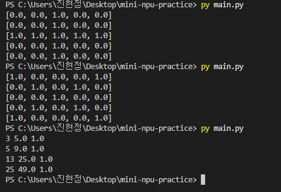

이 함수들은 성능 분석에서 크기별 패턴을 만들 때 다시 사용합니다.

## 보너스: 1차원 배열 최적화

2차원 배열(`pattern[i][j]`)을 길이 N²의 1차원 배열로 펼쳐서 접근 방식을 단순하게 만들고, 최적화 전/후 성능을 비교했습니다.

- `flatten(matrix)`: 2차원 배열의 줄을 이어 붙여 1차원 배열로 만듭니다.
  `[i][j]` 자리는 1차원에서 번호 `i * n + j`가 됩니다.
- `mac_flat(pattern_flat, filter_flat)`: 반복문 한 겹으로 같은 번호끼리 곱해서 더합니다.
  2차원 `mac()`은 반복문이 두 겹이고 값을 꺼낼 때마다 줄과 칸을 두 번 찾지만, 1차원은 번호 하나로 한 번만 찾습니다.

```python
def flatten(matrix):
    flat = []
    for row in matrix:
        for value in row:
            flat.append(value)
    return flat


def mac_flat(pattern_flat, filter_flat):
    total = 0.0
    for k in range(len(pattern_flat)):
        total += pattern_flat[k] * filter_flat[k]
    return total
```

두 방식의 점수가 같은지 먼저 확인했습니다. (5×5 십자가끼리 `mac()`과 `mac_flat()` 모두 9.0)
성능 비교는 같은 입력과 같은 반복 횟수(10회 평균)로 했고, 배열을 펼치는 시간은 측정에서 제외했습니다.

```text
크기          2D(ms)    1D(ms)   1D/2D
------------------------------------
3×3         0.0009    0.0007   0.76
5×5         0.0020    0.0012   0.62
13×13       0.0104    0.0074   0.71
25×25       0.0353    0.0299   0.85
```

모든 크기에서 1차원 방식이 더 빨랐습니다(`1D/2D`가 1보다 작음).
곱셈 횟수는 N²로 같기 때문에 시간 복잡도는 그대로 O(N²)이고, 값을 찾는 비용이 줄어서 계산 한 번의 상수 부분이 작아진 것입니다.

## 결과 리포트

### 실행 결과

`data.json`으로 모드 2를 실행한 결과는 총 6개 중 통과 3개, 실패 3개입니다.
실패한 케이스는 `size_5_1`, `size_13_2`, `size_25_1`이고, 모두 두 점수가 같아서 판정이 `UNDECIDED`가 된 경우입니다.

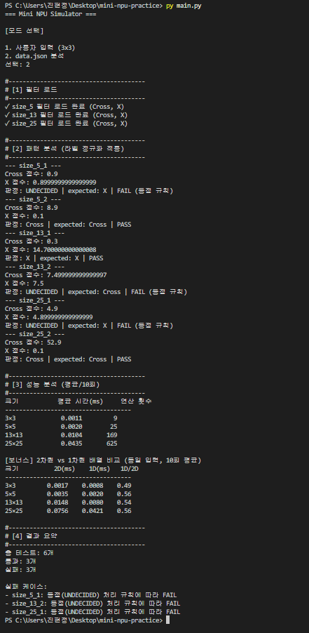

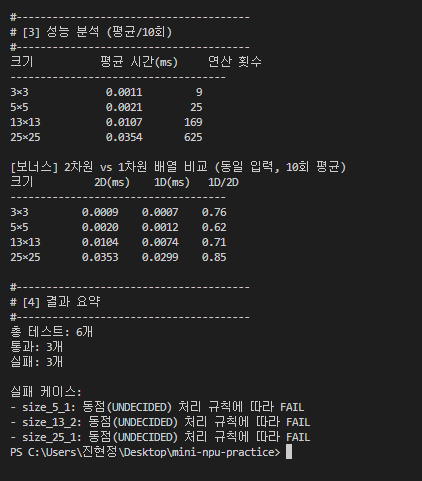

### 실패 원인 분석

실패한 3개의 원인을 데이터/스키마 문제, 로직 문제, 수치 비교 문제 순서로 나누어 확인했습니다.

1. **데이터/스키마 문제가 아닙니다.** 세 케이스 모두 키 형식(`size_N_idx`), `input`/`expected` 존재, 필터 존재, 패턴 크기(N×N) 검사를 통과했습니다.
2. **라벨 문제가 아닙니다.** `expected`의 `"x"`, `"+"`는 `normalize_label()`로 `X`, `Cross`로 바뀌어 비교됩니다. 정규화를 하지 않았다면 `"X" == "x"`가 거짓이라서 통과한 3개까지 포함해 6개가 모두 FAIL이 되었을 것입니다.
3. **MAC 계산 로직도 맞습니다.** 손으로 계산한 값과 프로그램의 점수가 같습니다.
   - `size_5_1`은 X 모양 입력입니다. Cross 필터와는 가운데 한 칸만 겹쳐 0.9이고, X 필터와는 1이 9칸(5+5-1) 겹치고 각 값이 0.1이라 9 × 0.1 = 0.9입니다.
   - `size_13_2`는 십자가 입력입니다. Cross 필터와는 25칸 × 0.3 = 7.5이고, X 필터와는 가운데 한 칸의 값 7.5가 겹칩니다.
   - `size_25_1`은 X 모양 입력입니다. Cross 필터와는 가운데 한 칸 4.9가 겹치고, X 필터와는 49칸 × 0.1 = 4.9입니다.
4. 즉 이 세 케이스는 수학적으로 두 점수가 **정확히 같아지도록** 필터 값이 설계되어 있어서, 필터만으로는 Cross와 X를 구분할 수 없습니다.
5. **원인은 수치 비교 문제입니다.** 컴퓨터는 0.1, 0.3 같은 소수를 2진수로 정확히 저장하지 못해서 같은 값이어야 할 점수가 `0.8999999999999999`, `7.499999999999997`, `4.899999999999999`처럼 아주 조금 어긋납니다. (부동소수점 오차)
6. 만약 epsilon 없이 `>`로만 비교했다면 이 오차 때문에 `size_5_1`과 `size_25_1`은 Cross로, `size_13_2`는 X로 우연히 판정되었을 것입니다. 결과는 똑같이 FAIL이지만 오차의 방향이 우연히 판정을 정하는 잘못된 결과입니다.
7. epsilon 정책(`abs(a - b) < 1e-9`)을 적용하면 두 점수의 차이가 `1e-15` 이하라서 동점으로 보고 `UNDECIDED`를 냅니다. 미션 규칙상 판정이 expected와 다르면 FAIL이므로 "동점 규칙에 따른 FAIL"로 기록합니다.
8. 나머지 3개(`size_5_2`, `size_13_1`, `size_25_2`)는 두 점수의 차이가 커서(예: 8.9와 0.1) 오차와 상관없이 정확히 판정되어 PASS입니다.
9. 정리하면 이 3개의 FAIL은 프로그램의 버그가 아니라, 구분할 수 없는 케이스를 정직하게 "판정 불가"로 알려준 결과입니다. 이 케이스들을 PASS로 만들려면 비교 정책이 아니라 필터의 값(데이터)을 고쳐서 두 점수 사이에 실제 차이가 생기게 해야 합니다.
10. 한편 일부러 틀린 데이터(`error_data.json`)를 넣은 경우에는 크기 불일치, 알 수 없는 라벨, 필터 없음, 스키마 오류, 키 형식 오류가 케이스 단위로 사유와 함께 FAIL 처리되고 프로그램은 멈추지 않습니다. 이것은 "데이터/스키마 문제"로 분류되는 FAIL입니다.

### 성능 표 해석과 시간 복잡도 분석

실행 결과 (컴퓨터마다 값은 조금씩 다릅니다):

| 크기 | 연산 횟수(N²) | 평균 시간(ms) |
|---|---|---|
| 3×3 | 9 | 0.0011 |
| 5×5 | 25 | 0.0020 |
| 13×13 | 169 | 0.0104 |
| 25×25 | 625 | 0.0435 |

1. N×N 패턴의 MAC 연산은 모든 칸을 한 번씩 곱하고 더하므로 곱셈이 정확히 **N²번** 일어납니다. 따라서 시간 복잡도는 **O(N²)** 입니다.
2. 3×3에서 25×25로 가면 연산 횟수는 9에서 625로 약 69배 늘어납니다. 측정 시간은 0.0011ms에서 0.0435ms로 약 40배 늘어났습니다.
3. 시간이 69배가 아니라 40배만 늘어난 이유는 크기가 작을 때 함수 호출, 반복문 준비 같은 고정 비용이 전체 시간에서 차지하는 비율이 크기 때문입니다.
4. 크기가 커질수록 고정 비용의 비율이 줄어서 연산 횟수와 시간이 비슷하게 늘어납니다. 13×13에서 25×25로 갈 때 연산 횟수는 약 3.7배(169 → 625), 시간은 약 4.2배(0.0104 → 0.0435)로 거의 같습니다.
5. 따라서 N이 2배가 되면 시간은 약 4배가 됩니다. 필터가 수백×수백 크기이고 수천 개씩 쓰이는 실제 AI 모델에서는 연산량이 매우 빠르게 커지므로, 많은 MAC 연산을 동시에 처리하는 NPU 같은 병렬 하드웨어가 필요합니다.
6. 측정값은 실행할 때마다 조금씩 달라집니다. 처음 실행은 준비 시간 때문에 느려서 측정 전에 한 번 미리 실행(워밍업)했고, 10번 반복한 평균을 사용했습니다.
7. 보너스로 만든 1차원 배열 방식은 2차원 방식의 약 50~85% 시간으로 더 빨랐습니다. 곱셈 횟수는 똑같이 N²이므로 시간 복잡도는 여전히 O(N²)이고, 값을 찾는 비용이 줄어서 계산 한 번의 상수 부분만 작아진 것입니다.

